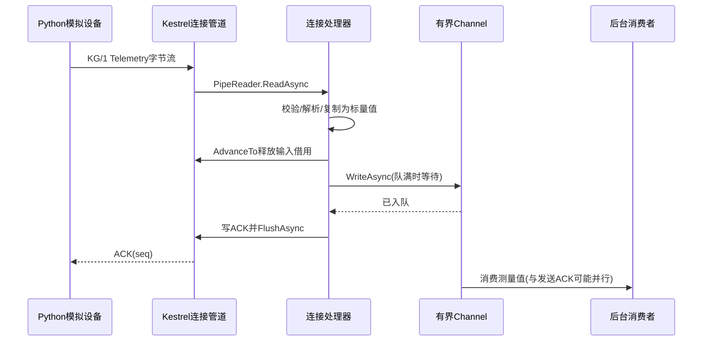

# 第 19 章：亲手运行工业采集网关

这一章把前面的概念连接为一个可执行系统。不要追求第一次就理解所有代码；先预测结果，运行并观察，再回到设计。我们故意让协议很小，让你把注意力放在连接与内存边界上。

## 19.1 实验的交付物和承诺

虚拟设备 42 上报一个测量值 `23500`，代表 23.500 个预先约定单位。网关解析报文，转换为拥有自身值的 `Telemetry`，进入有界队列，返回相同序号的 ACK。后台消费者读取并记录调试日志。

它不把数据写入数据库。ACK 只表示服务器已经成功入队；进程随后退出、消费者还没处理、或设备没收到 ACK，都可能造成丢失或重发。先把这个承诺讲清楚，才谈得上可靠性改造。



关键关系是入队完成先于写 ACK，消费和 ACK 之间没有固定先后。即使后台处理已经完成，设备也可能因断网收不到 ACK。这个不确定窗口不是增加一个 `await` 就能抹掉的。

## 19.2 环境准备：先确认运行的是哪一代程序

要求安装稳定 .NET 10 SDK 和 Python 3。检查命令本身不会安装软件：

```bash
dotnet --list-sdks
python3 --version
```

新项目在 [samples/IndustrialGateway](../../../samples/IndustrialGateway/README.md)，没有加入原解决方案，因此不需要先构建旧 Fiddler 或安装 .NET 6/7。从仓库根执行：

```bash
cd samples
dotnet run --project IndustrialGateway/IndustrialGateway.csproj -c Release
```

进入 `samples` 很重要：SDK 从当前工作目录向上寻找 [global.json](../../../samples/global.json)。这里选择稳定 .NET 10 并允许同一大版本内适合的 feature band；不选择机器上的 .NET 11 预览版。不要把 SDK 版本选择和程序目标框架混为一谈。

默认有两个监听：`127.0.0.1:7810` 为裸 TCP 自定义协议，`127.0.0.1:7812` 为 HTTP/1。没有 7811。Kestrel 启动日志即使把 7810 显示为 `http://...`，也不意味着它会处理 HTTP——最终解释字节的是已注册的连接处理器。

另开终端，从仓库根执行：

```bash
python3 samples/IndustrialGateway/simulator.py
curl http://127.0.0.1:7812/health
```

模拟器应输出三个匹配序号的 ACK；健康检查应返回 `status: ok`、当前 `queued` 和 ACK 语义。`queued` 为零只说明此刻等待队列为空，不说明数据库正常，也不说明消费者没有持有正在处理的数据。默认消费者不逐条打印 Information 日志；否则控制台常会成为主要性能瓶颈。

## 19.3 用一帧字节验证自己的心智模型

KG/1 使用固定 16 字节头，多字节字段都采用大端：

| 偏移 | 长度 | 含义 |
|---|---:|---|
| 0 | 2 | `4B 47`，魔数 KG |
| 2 | 1 | 版本 `01` |
| 3 | 1 | 类型 `01` 为上报，`02` 为 ACK |
| 4 | 4 | 负载字节数，上报为 `00 00 00 10` |
| 8 | 8 | 无符号序号，例如 1 |
| 16 | 4 | 设备编号 uint32，例如 42 |
| 20 | 8 | Unix 毫秒时间 int64 |
| 28 | 4 | 测量值 int32，例如 23500 |

一条合法上报共 32 字节。负载上限 4096 是协议校验上限，不代表当前 Telemetry 可以任意长；此类型的负载严格要求 16。ACK 只有头，总长 16，负载长度零，回传原 Sequence。

为什么不用浮点数？本实验的千分单位整数让线格式、精度和跨语言实现简单。它不能自动表示所有真实测量范围；真实点表必须定义单位、量程、无效值和精度。为什么用 Unix 毫秒？它能跨语言交换，却不能证明设备时钟正确。生产库往往同时保存设备时间、网关接收时间和质量标志。

模拟器的 `struct.Struct("!HBBIQ")` 对应头部；`!` 指定网络大端和标准大小，避免 C# 与 Python 因主机端序或结构体填充产生分歧。服务端不把本地结构体直接转成字节，而在 [Protocol.cs](../../../samples/IndustrialGateway/Protocol.cs) 中用 `BinaryPrimitives` 显式读写。

## 19.4 顺着五个文件读完处理链

先读 [Program.cs](../../../samples/IndustrialGateway/Program.cs)。它把队列、名额、指标和 handler 注册为共享服务，并把协议端口连接到 `UseConnectionHandler`。因此 handler 字段没有“每连接一份”的保证；本例字段都是可共享的依赖，连接局部变量放在方法内部。

再读 [Protocol.cs](../../../samples/IndustrialGateway/Protocol.cs)。`TryReadTelemetry` 的三种结果是：数据暂时不足返回 false；头或长度不合法抛异常；完整帧返回 true 并移动调用方的剩余切片。它先把固定小头复制到栈上，再检查长度，最后解析负载。这里的 32 字节小复制换来了简单、安全的跨段处理；“用高性能管道”不等于“拒绝每一次复制”。返回值只包含整数，之后释放输入内存不会使消息失效。

随后读 [GatewayConnectionHandler.cs](../../../samples/IndustrialGateway/GatewayConnectionHandler.cs) 中的 `ReadOneAsync`。每次拿到 ReadResult，就建立 `consumed` 和 `examined`，最后在 finally 中调用一次 AdvanceTo。成功解析一帧后，两者都指向剩余切片的开头，让下次调用立即看到同批到达的下一帧；尚不完整则不消费、但标记检查到末尾，等待更多数据。EOF 时如果还留着半帧，报 `truncated_frame`，不能假装这次连接干净完成。

然后读同文件的 `OnConnectedAsync`。一帧有一个绝对预算，包含读取、等待业务队列和刷出 ACK。`ReadOneAsync` 返回前已经结束输入借用，再等待入队，避免在慢业务阶段长期扣住管道内存。所有输出由这一条顺序处理路径负责，没有多个线程同时修改同一个 PipeWriter。

最后读 [TelemetryQueue.cs](../../../samples/IndustrialGateway/TelemetryQueue.cs)。满队列模式为 Wait，并非偷偷丢消息；容量约束的是等待元素，不包括消费者已取走但尚未处理完的元素。消费者只是教学日志 sink，停止时不提供排空承诺。

## 19.5 亲手观察半包与粘包

```bash
python3 samples/IndustrialGateway/simulator.py --split --count 2
python3 samples/IndustrialGateway/simulator.py --coalesce --count 10
```

`--split` 逐字节调用发送并加入短延迟；`--coalesce` 一次提交多帧。两者应得到完全相同的逻辑 ACK 顺序。这不是在控制 TCP 包边界：操作系统可能合并或拆开发送，接收方一次 Read 的范围也由缓冲决定。真正可重复的“头部每一个偏移跨内存段”由下一节的内存检查构造。

观察后回答：为什么长度字段不能按字符数填写？因为网络传输和这里的长度单位都是字节，UTF-8 的汉字可能占多个字节。为什么一次 Send 完成不能表示一条消息被消费？它甚至不能决定接收方 Read 的边界，更不能决定后台业务完成时点。

## 19.6 自动验证，先理解它证明了什么

从仓库根执行：

```bash
cd samples
dotnet run --project IndustrialGateway.Checks/IndustrialGateway.Checks.csproj -c Release
python3 IndustrialGateway/verify.py
```

[检查程序](../../../samples/IndustrialGateway.Checks/Program.cs) 不依赖测试框架，通过失败异常产生非零退出码。它构造所有不完整长度、所有双段切分点和逐字节分段；验证 false 不移动游标，完整解析输出一致，错误头在等待负载之前失败；还覆盖多帧 EOF、ACK 编码和满队列取消。

[真实连接验证脚本](../../../samples/IndustrialGateway/verify.py) 自动构建并使用临时 loopback 端口启动服务，验证协议错误不会把进程打挂、EOF 前的完整帧仍被处理、少量持续发送不能无限延长绝对预算，以及连接名额和队列如何限制资源。脚本会结束它创建的进程，不需要先手工启动默认端口的服务。

这些证明的是列举条件下的行为，不是高并发性能成绩、跨平台保证或持久化可靠性。不要把本机通过 162 项断言理解为“已达到工业部署标准”；测试条数也不等于覆盖率。

## 19.7 把后台故意调慢

停止手工服务，再从仓库根执行：

```bash
cd samples
dotnet run --project IndustrialGateway/IndustrialGateway.csproj -c Release -- --Gateway:QueueCapacity=1 --Gateway:ConsumerDelayMilliseconds=900 --Gateway:FrameTimeoutMilliseconds=3000
```

另一个终端运行合并上报 10 帧。ACK 应逐渐变慢。原因不是 TCP 出错，而是消费者每个元素花约 900ms，队列只能等待一个，后续 `WriteAsync` 必须等待。因为 handler 顺序处理，等待会传回协议接收链，而不是无界创建任务。

再把消费者延迟改为 2500ms、帧预算改为 1000ms。持续发送时，某一帧可能在等待队列中耗尽预算并被断开。这是一项明确过载策略：教学系统宁可拒绝继续工作，也不承诺无限缓存。客户端此时无法单凭断开判断最后一帧是否入队，必须依照 ACK 和幂等协议恢复。

水位不是总内存上限。Socket 读写缓冲各配置 16KiB，是流控阈值；还有内核缓冲、分配粒度、每连接对象、队列和消费者工作集。降低队列并不能替代总连接限制，降低 Socket 水位也不能替代合法帧长限制。

## 19.8 一次真实故障带来的规则

本实验最初把 `connection.ConnectionClosed` 链接到每帧取消令牌，在真实 socket 的发送半关闭检查中丢掉了尚未处理的完整帧。原因是 .NET 10 Socket transport 接收 FIN 后可以先完成输入并触发连接通知，而应用管道里仍有数据。

修正后，正常输入结束由 Pipe 的 EOF/异常决定；主机停止主动取消，每帧预算限制其他等待。确定性管道检查和真实 socket 检查承担不同责任：前者证明解析与游标，后者发现生命周期集成问题。不要只看命名就把 ConnectionClosed 当成“业务已经处理完”的信号。相关版本源码和结论见[验证记录](../appendices/validation.md)。

## 19.9 本章验收

在不看答案时，画出一个收到两帧、队列满、随后设备断开的时序。标明哪一步还在借用输入，哪一步可以释放，哪一步决定 ACK 承诺。参考解释：解析完整标量后 Advance，入队可等待，成功入队才创建 ACK；断开可能发生于任意两步，且 ACK 丢失不代表没有入队。若你能把这个不确定窗口解释清楚，就已经从“会调用 Send/Receive”走向了能设计网络协议。
